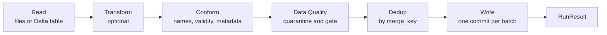

# Data Processing Framework

A data processing framework built on Spark and Delta Lake. It reads files or Delta tables, applies transformation, conformation, data quality and dedup, and writes to Delta tables. Common loads are configured with text parameters only; out-of-pattern cases get sub-parameters or extension points in code.

> **Status:** v1 is specified in [docs/spec.md](docs/spec.md); the code has not been implemented yet.

## How it works



- **Read:** reads only what is new since the last load, by comparing the source with what is already written on the target.
- **Transform:** an optional `transform(df, ctx)` function for load-specific logic.
- **Conform:** renames columns, fixes names Delta does not accept, resolves each row's validity and adds the metadata columns.
- **Data Quality:** converts types and applies rules; failing rows go to a quarantine table, and a gate can block the batch.
- **Dedup:** when there is a `merge_key`, keeps one row per key (or, in SCD2, one per change).
- **Write:** writes with `append`, `overwrite`, `replace_where` or `upsert`, with or without SCD2.
- **RunResult:** the run returns a summary of what was read, written and rejected, plus the status.

## Examples

Every pipeline is configured with a dictionary and run the same way:

```python
config = PipelineConfig.from_dict(params)
result = Pipeline(config).run()

print(result.status, result.rows_inserted, result.rows_quarantined)
```

### 1. Table to table, with history (SCD2)

```python
params = {
    "source": "bronze.customers",
    "target": "silver.customers",
    "write_mode": "upsert",
    "merge_key": "customer_id",
    "modified_date": "updated_at",
    "scd2": True,
    "rename_columns": [{"CUST_CD": "customer_id"}, {"CUST_NM": "name"}],
    "data_types": {"customer_id": "int"},
    "quarantine_table": "silver.customers_quarantine",
}
```

- Reads only the rows whose `updated_at` is newer than what is already on the target.
- Renames the columns and converts `customer_id` to integer; rows that do not convert go to quarantine.
- Keeps each customer's history: the previous version is closed and the new one is inserted in the same commit.

### 2. Reading with a query

```python
params = {
    "strategy": "fixed_query",
    "query": """
        SELECT s.sale_id,
               s.amount,
               c.segment,
               GREATEST(s.updated_at, c.updated_at) AS updated_at
        FROM silver.sales s
        JOIN silver.customers c
          ON c.customer_id = s.customer_id
         AND c._is_current
    """,
    "target": "gold.fact_sales",
    "write_mode": "upsert",
    "merge_key": "sale_id",
    "modified_date": "updated_at",
}
```

- The query can have joins, filters and computed columns.
- The framework applies the checkpoint over the query result: only rows whose `updated_at` is newer than what is already written get in. `GREATEST` makes a change in either table bring the sale again.
- With `strategy = "custom_query"`, the query defines the whole slice, with no framework checkpoint.

### 3. Files to a Delta table

```python
params = {
    "source": "/raw/system_x/customers",
    "file_format": "parquet",
    "target": "bronze.customers",
    "write_mode": "append",
    "chunk_size": 5,
}
```

- Reads only the files that arrived after the last file written, in batches of 5.
- Each row gets the source file's path and modification time, plus the run and the write time.
- New columns in the files are added to the target automatically.
- If a batch fails, the previous ones remain written and the next run resumes from the failed batch.

## Key concepts

| Concept | What it answers | Where it is defined |
|---|---|---|
| **Validity** | From when is this version of the row valid? | `modified_date`: a source column, the file date, a date in the path or a fixed value |
| **Checkpoint** | What has not been read yet? | The maximum of a column on the target: the `modified_date` one or `checkpoint_column` |
| **Version order** | Which version is the newest, when the date is not enough? | `order_column`, for example a sequence number |
| **Technical record** | When, by which run and from which file was the row written? | Automatic: `_run_id`, `_created_ts`, `_updated_ts`, `_source_file_path`, `_source_file_modified_ts` |

The framework uses no control table: **the target is the state**. To reprocess, delete the rows from the target; the next run re-reads from there.

## Write modes

| Mode | When to use |
|---|---|
| `append` | Data that only arrives, such as the raw layer |
| `overwrite` | Replace the whole table on every load, such as full loads |
| `replace_where` | Replace whole periods, such as a reprocessed month |
| `upsert` | Keep one row per key, updated when a newer version arrives |
| `upsert` with `scd2` | Keep the version history of each key |
| `overwrite` with `scd2` | Rebuild the whole history on every load, when the source can bring late data |

## What a run returns

The `RunResult` includes, among others:

- `status`: `success`, `failed`, `gate_failed` or `no_new_data`;
- `rows_read`, `rows_inserted`, `rows_updated` and `rows_quarantined`;
- `rows_late`: rows not applied because they are older than the target's;
- `checkpoint`: how far the source was read;
- `warnings` and `error`.

The full list is in [docs/architecture.md](docs/architecture.md#runresult).

## Documentation

- [docs/architecture.md](docs/architecture.md): the full design, with diagrams and examples for each step.
- [docs/spec.md](docs/spec.md): the normative rules, with IDs, for implementers.
- [CONTRIBUTING.md](CONTRIBUTING.md): branches, commits, pull requests and versioning.
- [CLAUDE.md](CLAUDE.md): instructions for coding agents working in the repository.
