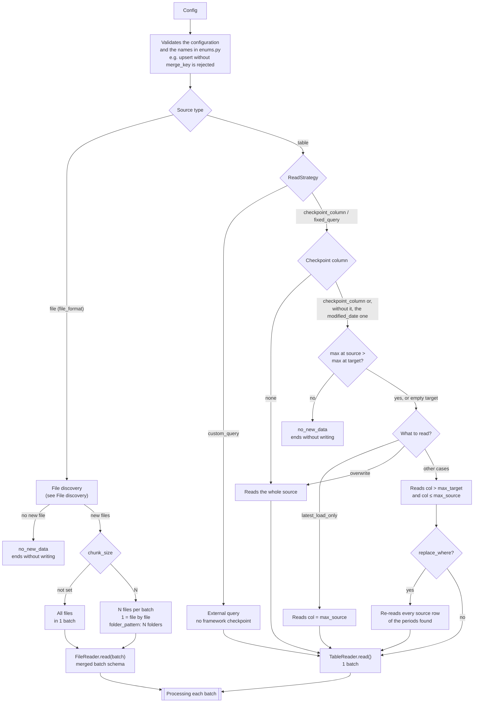
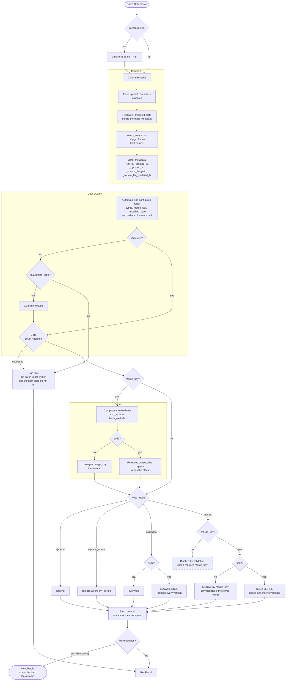
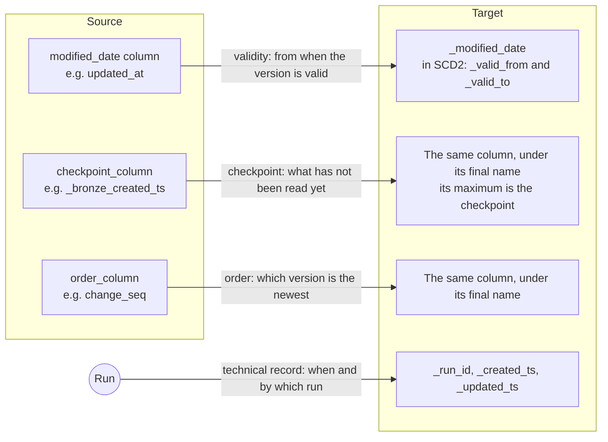
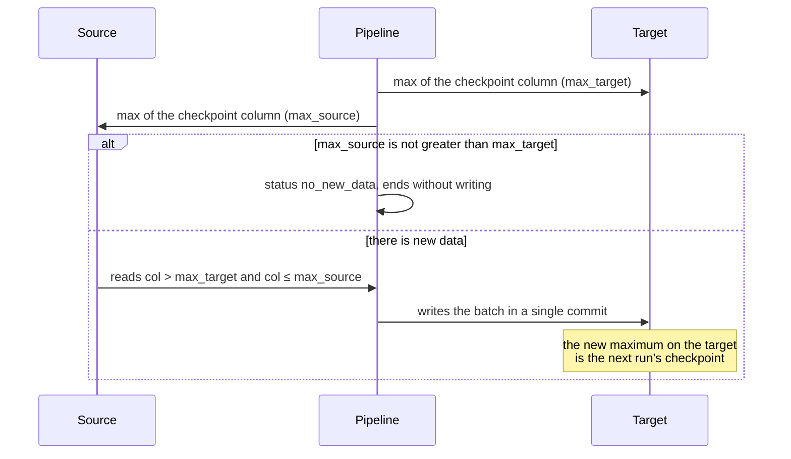
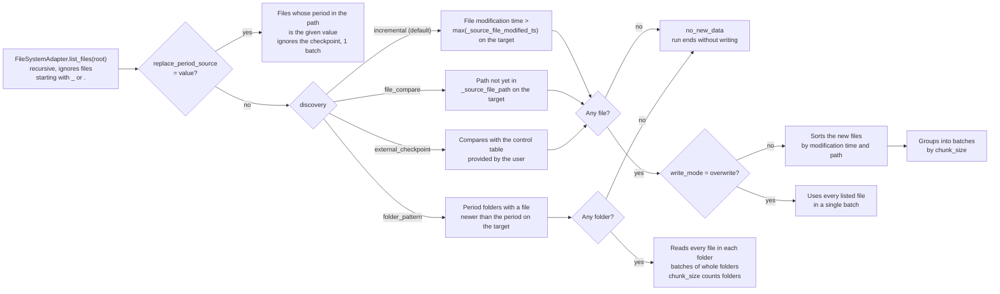
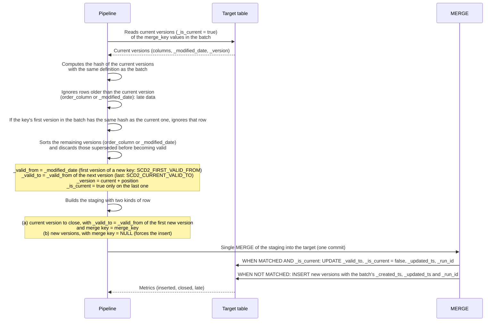
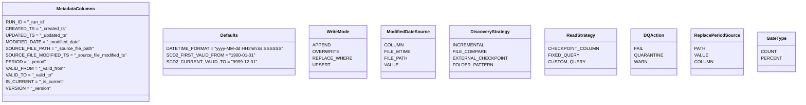
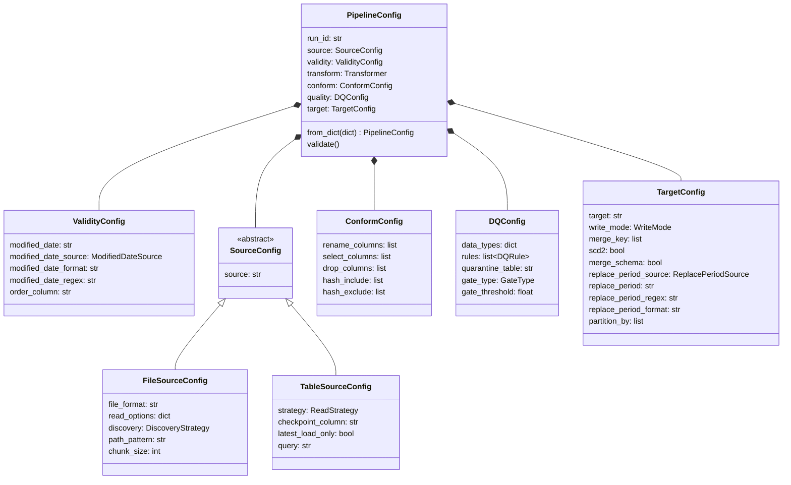
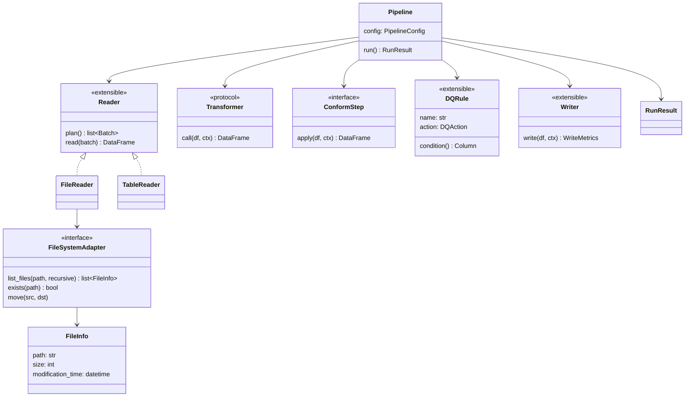

# Architecture

This document explains the framework's design with diagrams and examples, in the order data flows through the pipeline. The normative rules, for implementation, are in [spec.md](spec.md); if they diverge, the spec wins.

---

## Overview

A data processing framework built on Spark and Delta Lake. Every execution (run) goes through the same steps:

**Read → Transform (optional) → Conform → Data Quality → Dedup → Write → RunResult**

There are two kinds of source:

- **Files → Delta**
- **Delta → Delta**

Listing, checking and moving files depends on the runtime environment and sits behind the `FileSystemAdapter` interface. The rest of the framework only knows that interface. Per-row information about the source file (path, modification time) comes from Spark's own hidden `_metadata` column.

The flow has two parts: reading, which depends on the source, and processing, which is the same for every batch.

### Reading from the source



### Processing each batch



### General rules

- **Each batch is a single commit.** The whole batch is written or none of it is. Each written batch already advances the checkpoint, because the checkpoint is the maximum on the target.
- **Any error stops the run.** If a file in the batch fails (read, schema, write, DQ without quarantine or gate exceeded), no row of the batch is written and the following batches are not processed. Previous batches remain written, and the next run resumes from the failed batch. A row sent to quarantine is not an error.
- **The same pipeline should not run in parallel.** Two simultaneous runs see the same checkpoint and, in append, write the same data twice.

---

## Principles

### Simple on the common path, flexible off it

Configuration complexity follows the complexity of the case:

1. **Common path:** text parameters only: `source`, `target`, `file_format`, `modified_date`, `write_mode`, `merge_key`, `scd2`, `rename_columns`, `data_types`. No extra structure.
2. **Out-of-pattern cases:** sub-parameters add context. Examples: there is no change-date column, the date is in the path, files must be read in groups.
3. **Very specific cases:** extension points in code:
   - a `transform(df, ctx)` function for transformation logic;
   - overriding the `Reader` for very different sources;
   - overriding the `Writer` for unusual writes;
   - custom DQ rules (`DQRule`).

Nothing that only rare cases need should make the common-path configuration more complex.

### Dates are the configurer's choice

The framework does not decide on its own which date represents a row's validity or how to identify what is new. Parameters let you choose among the available sources (source column, file date or path, provided value), and the defaults cover the common case. The section [Validity, checkpoint and technical record](#validity-checkpoint-and-technical-record) explains each concept.

### Configurable names

Metadata column names, values accepted by parameters and default values live in `enums.py`. They can be changed in the file, for every pipeline, or overridden in code before a run (see [Enums](#enums)).

### Column names in parameters

Every parameter that references a column (`merge_key`, `modified_date`, `checkpoint_column`, `order_column`, `select_columns`, `drop_columns`, `hash_include`, `hash_exclude`, `data_types`) uses the **final name**, after the rename and the [special-character fix](#special-characters-in-names). Only `rename_columns` uses the source name. When the framework needs to filter the source, it translates the name through the rename map.

### The target is the state

The framework does not depend on a control table or a log process. What has already been processed is found by querying the target itself (see [Checkpoint](#checkpoint)), and each run's information is returned in the `RunResult`.

---

## Configuration

### Common path

```python
source         = "bronze_sales"                 # table name or path
target         = "silver_sales"                 # table name or path
modified_date  = "updated_at"                   # required with merge_key
write_mode     = "upsert"                       # a WriteMode value
merge_key      = ["sales_id"]                   # str or list; names AFTER rename
scd2           = False                          # default
rename_columns = [{"SALES_CD": "sales_id"}, {"AMT": "amount"}]
data_types     = {"sales_id": "int", "amount": "decimal(18,2)"}
```

- `run_id` (optional): run identifier sent by the orchestrator. Without it, the framework generates one.

### Source and target

- **Source:** with `file_format`, `source` is a folder of files; without it, `source` is a Delta table. With `fixed_query` or `custom_query`, `source` is optional and only identifies the source in the `RunResult`.
- **Name or path:** in `source` and `target`, a value containing `/` is a path; without `/`, it is a table name (`schema.table`).

File source example:

```python
source      = "/raw/system_x/customers"
file_format = "parquet"
target      = "system_x.customers"
write_mode  = "append"
chunk_size  = 5          # without chunk_size: all files in one batch
```

### Target creation

If the target does not exist, it is created on the first run with the schema of the final DataFrame plus the metadata columns (and the SCD2 columns, when `scd2 = True`). If the schema in the name (`schema.table`) does not exist either, it is created first.

### Transformation

When there is a transformation, it is a plain function that receives and returns a DataFrame:

```python
def transform(df, ctx):
    return df.filter("amount > 0")
```

---

## Validity, checkpoint and technical record

Every written row answers three different questions, and each has its own parameters and columns. There are three parameters for three purposes: `modified_date` gives the validity; `checkpoint_column` tells what is new, so nothing that arrived late is lost; and `order_column` gives the version order when the date is not enough.

| | Row validity | Checkpoint | Technical record |
|---|---|---|---|
| **Question** | From when is this version of the row valid? | What has not been read yet? | When, by which run and from which file did the framework write the row? |
| **Parameters** | `modified_date`, `modified_date_source` and, when the date is not enough to order, `order_column` | Table source: `checkpoint_column`. File source: `discovery` | None: it is automatic |
| **Columns** | `_modified_date`; in SCD2, also `_valid_from` and `_valid_to`. `order_column` is the table's own column | None of its own: it is the maximum, on the target, of `_modified_date` or of `checkpoint_column` | `_run_id`, `_created_ts`, `_updated_ts`, `_source_file_path`, `_source_file_modified_ts` |
| **Used in** | Dedup, SCD2, late data, upsert only when newer | Read filter | Auditing |



Without `checkpoint_column`, the checkpoint uses the `modified_date` column: at the source, the column given; on the target, `_modified_date`.

**Validity comes from the source or the extraction, never from the time the framework processes the data.** A run that processes at 10:00 a snapshot extracted at 03:00 cannot claim the row is valid since 10:00. When the source has no change column, the configurer chooses another source for validity: the file date, a date in the path or a value passed by the orchestrator (see [Row validity](#row-validity)).

Technical record columns are neither validity nor checkpoint by default, but they can be chosen as either one in the next layer. For example, `modified_date = "_source_file_modified_ts"` uses the file's arrival as validity, and a `checkpoint_column` with the previous layer's `_created_ts` reads the source in write order (see [Checkpoint](#checkpoint)).

### Examples

| Situation | Validity | Checkpoint (table source) |
|---|---|---|
| The source has a change column | `modified_date = "updated_at"` | The same column (default) |
| The extraction writes the run's start time to a column | `modified_date = "extracted_at"` | The same column (default) |
| The orchestrator passes the extraction time | `modified_date_source = "value"` | `checkpoint_column` set, for example the previous layer's `_created_ts` (see [Checkpoint](#checkpoint)) |
| The file's arrival is what counts | File source: `modified_date_source = "file_mtime"`. Table source: `modified_date = "_source_file_modified_ts"` | The previous layer's `_created_ts` (see [Checkpoint](#checkpoint)) |
| The extraction uses a database control number | The extraction time, through one of the rows above | `checkpoint_column` with the control number |
| The source has no change date, but has a sequence number | Date: `modified_date = "_source_file_modified_ts"`. Order: `order_column = "change_seq"` | The previous layer's write time (see [Checkpoint](#checkpoint)) |

In a file source, the checkpoint is always decided by [file discovery](#file-discovery), whatever the validity is.

A source column such as `updated_at` can be the validity and the checkpoint in every layer: just set `modified_date = "updated_at"` in each one.

---

## Reading

### Checkpoint

The checkpoint answers **what has not been read yet**. It is not stored anywhere: it is the **maximum, on the target**, of the column that identifies what is new, queried at the start of each run.

- **Table source:** the column is `checkpoint_column` (see below).
- **File source:** it is the modification time of the files already written, or the list of paths (see [File discovery](#file-discovery)).

In a table source, the checkpoint column has two sides: the name at the source, used in the read filter, and the name on the target, where the framework queries the maximum.

| Situation | At the source | On the target |
|---|---|---|
| `checkpoint_column` not set and `modified_date` is a column | The `modified_date` column | `_modified_date` (already converted; the source filter applies the same conversion) |
| `checkpoint_column` set | The name before the rename | The final name. Must be `timestamp`, `date` or numeric |
| Neither | No checkpoint: the source is read in full on every run | — |
| Target does not exist yet | The first run reads everything | — |

In most loads, validity and checkpoint come from the same column, so `checkpoint_column` is optional. It is set when the two answers differ: for example, when the previous layer can receive rows out of order (a write-time column is safer) or when the extraction uses a control number.

**The column on the target must store the value that came from the source.** So it cannot have the name of a metadata column the run generates: with `checkpoint_column = "_created_ts"`, the run would write its own time there, and the checkpoint would compare the previous layer's time with this run's time. The configuration is rejected. To use the previous layer's `_created_ts`, rename the column; the rename links both sides:

```python
modified_date     = "dt_update"
rename_columns    = [{"_created_ts": "_bronze_created_ts"}]
checkpoint_column = "_bronze_created_ts"   # at the source: _created_ts
```

Another way is for each layer to write its own metadata names (see [Enums](#enums)). With `modified_date` as the checkpoint, this is not needed: the target side is always `_modified_date`, which stores the source value.

### Closed window



1. Query `max` of the column on the target (`max_target`).
2. Query `max` of the column at the source (`max_source`).
3. If `max_source` is not greater than `max_target`, the run ends with status `no_new_data`, without writing.
4. Read `column > max_target AND column <= max_source`.

Rows arriving at the source during the read are left for the next run. With `overwrite`, steps 1 to 3 still apply, but the read covers the whole source (see [overwrite](#overwrite)).

### Queries

When the read needs more than a table (joins, filters, computed columns), the source can be a query:

- **`fixed_query`:** the checkpoint window is applied over the query result. The query only needs to return the checkpoint column.
- **`custom_query`:** the query defines the whole slice and is read on every run, with no framework checkpoint.

```python
strategy      = "fixed_query"
query         = """
    SELECT s.sale_id, s.amount, c.segment,
           GREATEST(s.updated_at, c.updated_at) AS updated_at
    FROM silver.sales s
    JOIN silver.customers c ON c.customer_id = s.customer_id AND c._is_current
"""
target        = "gold.fact_sales"
write_mode    = "upsert"
merge_key     = "sale_id"
modified_date = "updated_at"
```

With a query, `source` is optional and only identifies the source in the `RunResult`.

### Accumulated full loads at the source

Some sources receive a whole full load on every extraction, always appended. The source table accumulates several complete copies of the data, one per load:

| id | name | `bronze_load_ts` |
|---|---|---|
| 1 | Ana | 2026-10-01 03:00 |
| 2 | Bruno | 2026-10-01 03:00 |
| 1 | Ana | 2026-10-02 03:00 |
| 2 | Bruno Silva | 2026-10-02 03:00 |
| 3 | Carla | 2026-10-02 03:00 |

The target should reflect only the most recent load (the three rows from 2026-10-02). Reading the normal window (`> max_target`) would bring every load that arrived since the last run, with the same rows repeated.

With `latest_load_only = True`, the read filters `checkpoint_column = max_source`:

```python
write_mode        = "overwrite"
checkpoint_column = "bronze_load_ts"
latest_load_only  = True
```

- The column must have **the same value in every row of a load**. The previous layer's `_created_ts` works when the whole load was written in a single batch, because it is set per batch. This also allows treating several different files written in the same batch as one load. When the load has several files read in different batches, use an identifier that comes from the extraction, such as the date or the folder in the path.
- The overwrite only happens when the source load is newer than the one written on the target. If the last load has already been processed, the run ends as `no_new_data` and the target is not rewritten.
- If the source column has the same name as a metadata column the run generates (for example, `_created_ts`), rename it in `rename_columns`, as with any checkpoint column. Without the rename, the configuration is rejected.

### Checkpoint consequences

- **Reprocessing means deleting from the target.** Removing rows from the target lowers the maximum, and the next run re-reads from there.
- **Rows that do not reach the target are re-read on the next run.** This applies to late rows, rows equal to the current version and quarantined rows. In `upsert` (with or without SCD2), re-reading does not change the target. Quarantined rows go back to quarantine on every run until they are fixed at the source.
- **In `append`, the checkpoint must be exact.** Re-reading duplicates and skipping loses data. So append always requires a way to identify what is new: in a table source, `checkpoint_column`, `modified_date` as a column or `custom_query`; in a file source, file discovery already plays that role.
- **The checkpoint column cannot be dropped.** If it is in `drop_columns` or missing from `select_columns`, the configuration is rejected.

### File discovery



Listing is recursive and ignores files starting with `_` or `.` (for example, `_SUCCESS` and temporary files). A file with no rows writes nothing to the target, so it is read again in later runs; the cost is small.

Discovery only decides **which files to read**. Row validity is a separate choice (see [Row validity](#row-validity)).

Without `chunk_size`, all selected files go in a single batch; with `chunk_size = N`, they go N per batch (`1` = file by file). With `folder_pattern`, `chunk_size` counts folders (see [Periods with `replace_where`](#periods-with-replace_where)). With `overwrite`, discovery only decides whether there is a new file: if there is, every listed file is read in a single batch.

#### `incremental` (default)

Reads only the files whose modification time is greater than the largest `_source_file_modified_ts` on the target.

- **Order:** files are sorted by modification time (and path) before being grouped into batches. So if the run fails halfway, no file older than the checkpoint is left behind.
- **Ties:** the filter is `>`, so a file with the same modification time as the target's maximum is not read. For example: two files with the same time, where only one was loaded in the previous run. In spaced-out loads this does not happen. If the source can produce ties, use `file_compare`.
- **Rewritten file:** it gets a new modification time and is read again. In append, its content goes in twice.
- `_source_file_modified_ts` cannot be dropped from the target.

#### `file_compare`

Compares the source's file list with the paths already written on the target (`_source_file_path`) and reads only the files that are not there yet. It does not depend on dates, so it has no tie problem.

```python
discovery = "file_compare"
```

- `_source_file_path` cannot be dropped from the target.
- The written path and the listed path use the same normalization, so the comparison is exact.
- The cost grows with history: on every run, the whole source folder is listed and the distinct paths on the target are queried.
- A file's identity is its path. A file rewritten with the same name is not read again; to reprocess it, rename the file or delete that path's rows from the target.

---

## Conform

Conformation always runs in the same order: rename → special-character fix → validity (`_modified_date`) → column selection → other metadata.

### Rename

`rename_columns` is a list of pairs source name → final name. It also accepts a single dictionary (`{"SALES_CD": "sales_id", "AMT": "amount"}`). It is the only parameter that uses the source name.

### Special characters in names

Delta does not accept column names with spaces, `,`, `;`, `{`, `}`, `(`, `)`, `=`, newlines or tabs. The fix always runs, right after the rename:

- each sequence of rejected characters becomes `_` (`Sale Date` → `Sale_Date`); case, accents and other characters are kept;
- changed names appear in `warnings` in the `RunResult`;
- if two names become equal after the fix (case-insensitively), the run fails;
- to choose another name, use `rename_columns`, which runs before the fix;
- the other parameters use the already-fixed name.

The names in `enums.py`, including those overridden in code, are also validated when the run starts.

### Row validity

The `modified_date` parameter defines **from when each version of a row is valid**. It is used to:

- order the dedup;
- define the SCD2 intervals;
- identify late data;
- decide, in upsert, whether the incoming row replaces the written one (only when it is newer).

When the date is not enough to order the versions, the order can come from another column (see [`order_column`](#order_column)).

It is required when there is a `merge_key`. Without `merge_key` (append, overwrite or replace_where without dedup) there are no versions to compare, and the parameter is optional.

The resolved value is written to `_modified_date` as a timestamp, with no time zone conversion: a `timestamp` column keeps the source value, and a string without a time zone is interpreted in the Spark session time zone. In a table source, when `modified_date` is a column, it is also the default checkpoint (see [Checkpoint](#checkpoint)).

`_modified_date` is resolved before column selection and the other metadata. So the source column can be dropped with `drop_columns` after becoming `_modified_date`, and it can even have the name of a metadata column the run generates (for example, the previous layer's `_created_ts`): the value is read before it is overwritten.

#### Common path

```python
modified_date = "updated_at"
```

If the column is a string, set the format:

```python
modified_date        = "dt_change"
modified_date_format = "dd/MM/yyyy HH:mm:ss"
```

The default string format is `yyyy-MM-dd HH:mm:ss.SSSSSS` (Spark date pattern). `timestamp` or `date` columns are not converted.

#### Other sources

`modified_date_source` tells where validity comes from. The default is `column`.

| `modified_date_source` | Validity source | Sub-parameters |
|---|---|---|
| `column` (default) | Column given in `modified_date` | `modified_date_format` |
| `file_mtime` | File modification time (`_metadata.file_modification_time`) | — |
| `file_path` | Date extracted from the file path | `modified_date_regex` (required), `modified_date_format` |
| `value` | Fixed value given in `modified_date`, the same for every row of the run | `modified_date_format` |

```python
# File arrival time
modified_date_source = "file_mtime"

# Date in the file name: sales_20261007.csv
modified_date_source = "file_path"
modified_date_regex  = r"_(\d{8})\.csv$"
modified_date_format = "yyyyMMdd"

# Fixed value (e.g. extraction time sent by the orchestrator)
modified_date_source = "value"
modified_date        = "2026-10-07 03:00:00"
```

The regex must have a capture group. The captured text is converted with `modified_date_format`.

#### Late file

With a file source, discovery decides which files to read and `modified_date` decides which row is valid:

```python
source        = "/raw/system_x/customers"
file_format   = "parquet"
target        = "silver.customers"
write_mode    = "upsert"
merge_key     = "customer_id"
modified_date = "dt_update"
```

| File | Arrival | Row | `dt_update` | Result |
|---|---|---|---|---|
| A | 10:00 | id 1, status X | 09:00 | Written |
| B | 11:00 | id 1, status Y | 08:00 | Read, because the file is new, but not applied: it is older than the written one |

The target keeps X, and the row is counted in `rows_late` in the `RunResult`. If A and B fall in the same batch, dedup keeps the one with the larger `dt_update` and the result is the same.

When the file has no column like `dt_update`, the choice of source changes the result: with `file_mtime`, B would win, because it arrived later; with `file_path`, if the extraction date is in the name, B would be recognized as older.

#### `order_column`

When the validity date is not enough to order the versions, `order_column` names the column that defines the order. The main case is a source without a change or creation date: validity comes from a metadata column (for example, the file date), but the source has a numeric order, such as a sequence number. It also helps when the source date only has the day and there are several changes on the same day.

```python
modified_date = "_source_file_modified_ts"   # validity date
order_column  = "change_seq"                 # version order
```

- With `order_column`, it decides which version is the newest: in dedup, in upsert (only updates when the order is greater), for late data and in the SCD2 sequence. `modified_date` then only provides the dates (`_modified_date`, `_valid_from`, `_valid_to`).
- Without `order_column`, `modified_date` does both.
- It accepts a number or any orderable type and is excluded from the hash, like the `modified_date` column.
- It does not become metadata: it is the table's own column, kept on the target under its final name, like `merge_key`, and used to compare the next rows. That is why it cannot be dropped.

**Order and date can disagree.** A file that arrives late can bring a version that is older by order but has a more recent date. In that case, the version that is older by order is discarded, because it was superseded before it became valid:

| Version | `change_seq` | `_source_file_modified_ts` | Result |
|---|---|---|---|
| A | 3 | 11:00 | Discarded: version 5 was already valid since 10:00 |
| B | 5 | 10:00 | Kept |

The result is the same if the two arrive in different runs: B is written first, and A, with a lower order, is treated as late data. Two versions with the same date follow the same rule: only the newest by order remains.

#### Known limitations

- **`file_mtime` records the file's arrival, not the row's validity.** A file that arrives late gets a later date than the real one. Without a column in the source or a date in the path, no other information is available.
- **Ties.** Rows from the same file (`file_mtime`), the same day (`file_path` with only a date) or the same load (`value`) have the same validity. When two rows of the same `merge_key` tie, the tie is broken by `order_column`, if set; otherwise deterministically by the row hash, and the number of ties appears in the `RunResult`.

### Column selection

`select_columns` and `drop_columns` control which columns reach the target. They are mutually exclusive and use final names:

```python
drop_columns   = ["technical_column"]                  # all but these
select_columns = ["customer_id", "name", "email"]      # only these
```

Selection happens before the other metadata. If the source already has columns with the same names as the metadata the framework generates in this run (for example, `_created_ts` from a previous layer), they are overwritten, and the `RunResult` records a warning. Metadata the run does not generate (such as `_source_file_modified_ts` in a table read) is kept. To preserve these columns, write different names in each layer (see [Enums](#enums)) or rename them in `rename_columns`; to discard them, use `drop_columns`. The exception is the checkpoint column: if it has the name of a metadata column the run generates, the configuration is rejected (see [Checkpoint](#checkpoint)).

### Metadata

Last, the run adds the technical record columns (`_run_id`, `_created_ts`, `_updated_ts` and, in a file source, `_source_file_path` and `_source_file_modified_ts`). They are added before DQ, so quarantined rows already have the run, the write time and the file path. The full list is in [Metadata columns](#metadata-columns).

---

## Data Quality

DQ runs after Conform and **before dedup**. So dedup only chooses among valid rows, and a key with one valid row and one invalid row does not disappear from the batch.

```python
data_types       = {"customer_id": "int", "amount": "decimal(18,2)"}
quarantine_table = "silver.customers_quarantine"
gate_type        = "percent"
gate_threshold   = 2
```

### Rules

- **Automatic:** `merge_key`, `_modified_date` and `order_column` (when set) not null. Failing rows go to quarantine.
- **`data_types`:** converts the columns to the given types. A row whose value does not convert goes to quarantine; valid rows are written already converted.
- **Custom rules (`DQRule`):** each rule has an action:
  - `FAIL`: a failing row fails the run;
  - `QUARANTINE`: the row goes to quarantine;
  - `WARN`: the row continues and is counted in `dq_by_rule`.

### Quarantine

- Failing rows are written to `quarantine_table`. Without `quarantine_table`, a row that would go to quarantine fails the run, including for automatic rules.
- Because the checkpoint is the maximum on the target, quarantined rows are read again on every run and go back to quarantine until they are fixed at the source.

### Gate

The gate evaluates each whole batch, after the rules:

- `count`: exceeded when the number of quarantined rows exceeds `gate_threshold`;
- `percent`: exceeded when the percentage of quarantined rows over rows read exceeds `gate_threshold` (0 to 100).

If the threshold is exceeded, the batch is not written and the run ends with `gate_failed`. The quarantine is written anyway, so it can be investigated. Without `gate_type`, there is no gate.

---

## Dedup

Runs whenever there is a `merge_key`, after DQ.

### Row hash

Compares row content. By default, it considers every column except those given in `modified_date` and `order_column` and columns starting with `_`, the metadata column prefix. So a change only in the date does not create a new version, and neither does metadata coming from another layer (for example, `_bronze_created_ts`). If the source has business columns starting with `_`, use `hash_include`. To adjust, use one of the two parameters (they are mutually exclusive):

```python
hash_exclude = ["ingested_at"]                  # all but these
hash_include = ["name", "email", "status"]      # only these
```

The hash is not written to the target. In SCD2, the hash of the current version is computed on the fly, with the same definition used for the batch. So changing `hash_include` or `hash_exclude` does not create false versions.

### Rules

**Without SCD2:** keeps one row per `merge_key`, the newest (highest `order_column`, when set; otherwise highest `_modified_date`). This is mandatory for upsert, because Delta's MERGE fails when two source rows match the same target row.

**With SCD2:** removes only consecutive repeats, keeping the oldest. Sorted by version order (`order_column` or `_modified_date`), each row is compared with the previous row of the same key (`lag` of the hash).

| id | status | `_modified_date` | Result |
|---|---|---|---|
| 1 | A | t1 | kept — first version |
| 1 | A | t2 | **removed** — same as the previous one |
| 1 | B | t3 | kept — change |
| 1 | A | t4 | kept — back to A, which is a change |

---

## Write

| Mode | What it does |
|---|---|
| `append` | Inserts the new rows |
| `overwrite` | Replaces the whole target |
| `replace_where` | Replaces the periods present in the batch |
| `upsert` | Inserts new keys and updates existing ones when the incoming row is newer |
| `upsert` with `scd2 = True` | Keeps the version history incrementally |
| `overwrite` with `scd2 = True` | Rebuilds the whole history on every load |

`scd2 = True` is only accepted with `upsert` or `overwrite`. In every mode, each batch is written in a single commit.

### `append`

Inserts the batch's rows. Since re-reading duplicates and skipping loses data, append always requires a way to identify what is new (see [Checkpoint consequences](#checkpoint-consequences)).

### `overwrite`

Replaces the whole target, in a single batch:

- **The read covers the whole source.** The checkpoint only decides whether there is something new: if there is not, the run ends as `no_new_data` and the target is not rewritten. Reading only the window would erase what was already written.
- **With `latest_load_only`**, it reads only the most recent load (see [Accumulated full loads at the source](#accumulated-full-loads-at-the-source)).
- **In a file source**, if there is a new file, every listed file is read.
- **`chunk_size` is not accepted**, because the whole target is replaced at once.

### Periods with `replace_where`

`replace_where` replaces on the target the periods present in the batch. The period (for example, a month) is written to `_period` and used in the `replaceWhere` predicate. The period source is defined in `replace_period_source`:

| `replace_period_source` | Source | Period |
|---|---|---|
| `path` (default in a file source) | File | Extracted from the path with `replace_period_regex` and `replace_period_format` |
| `value` | File | Value given in `replace_period`, for example by the process that calls the pipeline |
| `column` (default in a table source) | Table | Column given in `replace_period` |

Since the whole period is replaced, it must arrive whole in the batch. That depends on how the data is organized.

**One file per period.** Each file holds the complete period (for example, `sales_2026-08.parquet`). The default discovery (`incremental`) already works: each new file replaces its period, and `chunk_size` groups files normally.

```python
write_mode            = "replace_where"
replace_period_regex  = r"_(\d{4}-\d{2})\.parquet$"
replace_period_format = "yyyy-MM"
```

**One folder per period.** The period is the folder (for example, `2026-08/`), with several files. Reading only the new files would replace the period with incomplete data, so the read unit becomes the whole folder, with `discovery = "folder_pattern"`:

- A folder is selected when it has at least one file newer than the largest `_source_file_modified_ts` written for that period on the target, or when the period does not exist on the target yet.
- Every file in the selected folder is read, including those already written.
- Batches are made of whole folders, and a period is never split across batches. Here `chunk_size` counts folders, not files.
- A file deleted from the folder does not trigger reprocessing: the period is only re-read when a newer file arrives.

```python
discovery             = "folder_pattern"
write_mode            = "replace_where"
replace_period_regex  = r"/(\d{4}-\d{2})/"
replace_period_format = "yyyy-MM"
chunk_size            = 1          # one period per batch
```

**Period given by another process.** The calling process passes the period to process:

```python
write_mode            = "replace_where"
replace_period_source = "value"
replace_period        = "202608"
replace_period_regex  = r"/(\d{6})/"
replace_period_format = "yyyyMM"
```

- `source` is still the root. `replace_period_regex` extracts the period from each path, and only files whose period is the given value are read.
- The value uses the same format as the period in the path (`replace_period_format`).
- The checkpoint is ignored: the period is read and replaced even without a new file, because the decision to reprocess came from the caller.
- Every file of the period goes in a single batch.

**Table source.** The period comes from a source column:

```python
write_mode     = "replace_where"
replace_period = "year_month"     # replace_period_source = "column" is the default in a table source
```

- With a checkpoint, the window identifies which periods have new rows, and the framework re-reads every source row of those periods before replacing them. Otherwise, the rows that did not change would be deleted from the target.
- Without a checkpoint, the source is read in full and every period present is replaced.
- With `custom_query`, the query defines what is read and must return complete periods, including when the period comes from the calling process. The framework replaces the periods present in the result.

In every case, `modified_date` is still each row's validity, used in dedup within the period, and data that arrived late goes into its period's next load.

### `upsert`

MERGE by `merge_key`. New keys are inserted; existing keys are only updated when the source row is newer than the target row (by `order_column`, when set, or by `_modified_date`). Older rows are not applied and appear in `rows_late` in the `RunResult`.

### SCD2

The batch arrives already free of consecutive repeats (Dedup step) and can have several versions of the same key.



The row to close and the new versions go in the **same MERGE**. So every change lands in a single Delta commit, and no snapshot of the table has the old version already closed without the new one inserted (or the other way around).

#### Validity intervals

- The interval is closed at the start and open at the end: a version's `_valid_to` equals the next version's `_valid_from`. The date join is `date >= _valid_from AND date < _valid_to`. With `BETWEEN`, the exact switch date would match two versions.
- The first version of each key starts at `SCD2_FIRST_VALID_FROM` (default `1900-01-01`), so dates before the first load still find a version. With `None`, the first version uses the real validity.
- The current version ends at `SCD2_CURRENT_VALID_TO` (default `9999-12-31`), so the date join works without handling nulls. With `None`, the current version's `_valid_to` is null.
- `_modified_date` is still written in every version. In the first one, it holds the real validity, used for the late-data check when there is no `order_column`.

Both values live in `enums.py` (see [Enums](#enums)).

#### Late data

A row older than the current version on the target (`order_column` or `_modified_date` less than or equal) is not applied, and the count appears in the `RunResult` (`rows_late`). It is not inserted in the middle of the history either.

When the source can bring late data and the history must reflect the real order, the recommendation is to use `overwrite`, which rebuilds the whole history on every load. SCD2 is usually applied to smaller tables, such as master data and dimensions, where rebuilding on every load is feasible.

#### SCD2 with overwrite

With `write_mode = "overwrite"` and `scd2 = True`, the run reads the whole source, builds every version of each key with the same rules as upsert (consecutive dedup, version order, validity intervals) and replaces the target. Since every version is computed together, a row that arrived late lands in the right place in the history.

- The source must keep every version, such as a previous layer written with append. If it only has the current state, the rebuild loses the history.
- `_created_ts` and `_updated_ts` become the rebuild time in every row.
- The target is replaced in a single commit, so no read sees a half-built history.

### Schema evolution

The files of a batch are read with the merged schema of all of them. Without this, Spark would use the schema of a single file, and a column present in only some of the files would be silently dropped. If a column has incompatible types across files of the same batch, the read fails.

On write:

| Change relative to the target | Behavior |
|---|---|
| New column | Added to the target (`merge_schema = True`, default). With `merge_schema = False`, the run fails listing the new columns |
| Column no longer present | Written as null in the new rows |
| Different type | The run fails: the batch is not written and the next ones are not processed |

A type change requires a decision from whoever maintains the pipeline. When the conversion is the desired behavior, `data_types`, a custom DQ rule or `transform` converts the column before the write. This does not solve type conflicts between files of the same batch, which fail at read time, before DQ.

---

## Metadata columns

| Column | When it exists | Content |
|---|---|---|
| `_run_id` | Always | Run of the row's last write |
| `_created_ts` | Always | Time of the batch that inserted the row. Never changes |
| `_updated_ts` | `write_mode = "upsert"` or `scd2 = True` | Time of the batch of the last write. On insert, equal to `_created_ts` |
| `_modified_date` | `modified_date` set | Row validity (see [Row validity](#row-validity)) |
| `_source_file_path` | File source | Path of the source file |
| `_source_file_modified_ts` | File source | Modification time of the source file |
| `_period` | `write_mode = "replace_where"` | The row's period: from the path, the given value or the column |
| `_valid_from`, `_valid_to`, `_is_current`, `_version` | `scd2 = True` | Version control (see [SCD2](#scd2)) |

By write mode, excluding the file columns and `_period`:

| Mode | Columns |
|---|---|
| append, overwrite, replace_where | `_run_id`, `_created_ts` (+ `_modified_date`, if set) |
| upsert | `_run_id`, `_created_ts`, `_updated_ts`, `_modified_date` |
| SCD2 (upsert or overwrite) | `_run_id`, `_created_ts`, `_updated_ts`, `_modified_date`, `_valid_from`, `_valid_to`, `_is_current`, `_version` |

- **Per-batch times.** `_created_ts` and `_updated_ts` receive the time the batch started being written, always after the previous batch's commit. That is why they are safe as the next layer's checkpoint: a batch written later always has a greater value than everything already visible, even if the next layer reads in the middle of a run.
- **Next layer's checkpoint.** In append, overwrite and replace_where tables, use `_created_ts`. In upsert or SCD2 tables, use `_updated_ts`, because it also changes when the row is updated and, in SCD2, when the version is closed. In the next layer, rename the column or write different names in each layer (see [Checkpoint](#checkpoint)).
- **`_run_id`.** Generated by the framework on every run, or received from the orchestrator through the `run_id` parameter, to link the rows to the orchestration log. In upsert, it changes together with `_updated_ts`.

### Naming convention

- Every framework column starts with `_`.
- Times recorded by the framework or by storage end in `_ts`: `_created_ts`, `_updated_ts`, `_source_file_modified_ts`.
- Validity columns follow the concept: `_modified_date` (same name as the parameter), `_valid_from`, `_valid_to`.

So the name alone tells technical record from validity. The row hash also depends on the `_` prefix (see [Row hash](#row-hash)). The names in this section are the defaults in `enums.py` and can be changed (see [Enums](#enums)).

---

## Enums



`enums.py` holds the metadata column names, the values accepted by parameters and the default values (date format, SCD2 start and end). There are two ways to change a value:

- **For every pipeline:** edit the value in `enums.py` (for example, `_valid_from` to `effective_start`).
- **For one run:** override the value in code before running the pipeline.

```python
MetadataColumns.RUN_ID = "_bronze_run_id"
MetadataColumns.CREATED_TS = "_bronze_created_ts"
Defaults.SCD2_FIRST_VALID_FROM = None
```

This way, each layer can write its own metadata names (`_bronze_run_id` in bronze, `_silver_run_id` in silver), and the next layer keeps the previous layer's columns, which preserves lineage. To avoid accumulating columns, use `drop_columns`.

The classes in `enums.py` are plain classes with attributes, not Python `Enum`, because an `Enum` member's value cannot be changed after it is created.

Caveats:

- **An override applies to the whole process** until it is undone. Pipelines running in sequence in the same process must set the values before each run, and pipelines running in parallel in the same process must use the same values.
- **Name changed on an existing table.** If a name changes after the table is created, the table does not have the column under the new name. When it is a column the run needs to read (the checkpoint column, `_modified_date` in upsert or the SCD2 columns), the run fails with a message instead of treating the target as empty.

---

## Contracts

### Configuration



### Execution



Classes marked as `extensible` have default implementations that can be overridden for specific cases.

---

## Validation

The configuration is validated before any read. The full list, with IDs, is in section 6 of the [spec](spec.md). Examples of rejected combinations:

| Combination | Reason |
|---|---|
| `target` or `write_mode` missing, or `source` missing without a query | Required parameters |
| `merge_key` set without `modified_date` | No way to order the versions |
| `order_column` without `merge_key` | No versions to order |
| `order_column` dropped (`drop_columns` or missing from `select_columns`) | The next run needs it to compare versions |
| `write_mode = "upsert"` without `merge_key` | MERGE needs the key |
| `scd2 = True` with `append` or `replace_where` | SCD2 updates versions (`upsert`) or rebuilds the history (`overwrite`) |
| `chunk_size` with `write_mode = "overwrite"` | Overwrite replaces the whole target, so it runs in a single batch |
| `chunk_size` with a table source | File batches only exist in a file source |
| `hash_include` with `hash_exclude` | Mutually exclusive parameters |
| `select_columns` with `drop_columns` | Mutually exclusive parameters |
| `modified_date_source = "file_path"` without `modified_date_regex` | No way to extract the date |
| `modified_date_regex` with `modified_date_source` other than `file_path` | The regex only applies to the path |
| `file_mtime` or `file_path` with a table source | There is no source file |
| `checkpoint_column` or `latest_load_only` with a file source | In a file source, what is new is decided by file discovery |
| `latest_load_only` without `checkpoint_column` or `modified_date` as a column | No way to identify the most recent load |
| `write_mode = "append"` with a table source, without `checkpoint_column`, without `modified_date` as a column and without `custom_query` | Every run would write the same data again |
| Checkpoint column dropped (`drop_columns` or missing from `select_columns`): `checkpoint_column`, `_source_file_modified_ts` in `incremental` or `_source_file_path` in `file_compare` | Without it, the next run does not know what has been read |
| `checkpoint_column` with the name of a metadata column the run generates (for example, `_created_ts`) | The target would store the run's own value, not the source's |
| `strategy` equal to `fixed_query` or `custom_query` without `query` | Nothing to read |
| `write_mode = "replace_where"` in a file source without `replace_period_regex` or without `replace_period_format` | No way to know each file's period |
| `write_mode = "replace_where"` in a table source without `replace_period` | No period column |
| `replace_period_source = "value"` without `replace_period` | No period provided |
| `replace_period_source` incompatible with the source (`path` or `value` in a table source, `column` in a file source) | In a file source, the period comes from the path or a value; in a table source, from a column |
| `discovery = "folder_pattern"` with a `write_mode` other than `replace_where` | The whole folder is re-read on every change; without replacing the period, data would be repeated |
| `gate_type` without `gate_threshold`, or the other way around | The gate needs both |

---

## RunResult

Returned at the end of every run, with the numbers aggregated across all batches.

| Field | Description |
|---|---|
| `run_id` | Run identifier (generated by the framework or received in the `run_id` parameter) |
| `source` / `target` | Source and target |
| `write_mode` | Write mode used |
| `modified_date_source` | Validity source used in the run |
| `started_at` / `finished_at` / `duration_s` | Run time |
| `status` | `success`, `failed`, `gate_failed` or `no_new_data` |
| `batches` | Number of batches processed |
| `files_read` | Files read (file source) |
| `rows_read` | Rows read |
| `rows_quarantined` | Rows sent to quarantine |
| `dq_by_rule` | Count and % of failures per rule |
| `gate` | Type, threshold, measured value and whether it passed |
| `rows_after_dedup` | Rows after dedup |
| `ties_resolved` | `_modified_date` ties within the same key broken by the row hash |
| `rows_late` | Rows not applied because they are older than the target |
| `rows_inserted` / `rows_updated` / `rows_closed` | Write metrics (`rows_closed` = SCD2 versions closed) |
| `periods_replaced` | Periods replaced (`replace_where`) |
| `checkpoint` | Checkpoint value at the start of the run and last value processed |
| `warnings` | Run warnings: fixed column names, new columns added to the target, overwritten metadata |
| `error` | Error message, when there is one |
